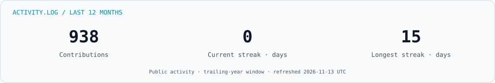
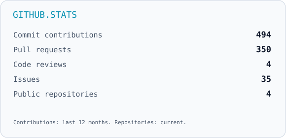
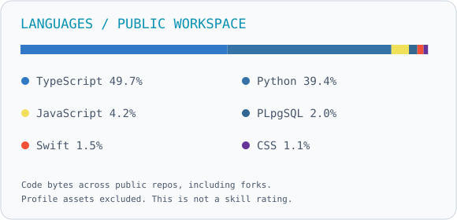

<!-- Terminal profile inspired by the GitHub Portfolio guide shared by Automation With Clarity.
     Generated assets live in this repository; GitHub Actions refreshes public metrics. -->
<picture>
  <source media="(prefers-color-scheme: dark)" srcset="https://raw.githubusercontent.com/smirthi-dharma/smirthi-dharma/main/dark.svg?v=readable3" />
  
</picture>

## About me

I'm Smirthika, an AI developer and full-stack builder interested in personal AI agents, consent-driven data experiences, and useful web applications. I work across interfaces, APIs, and automated tests, and contribute to open-source projects.

**Open to collaborating** on AI agents, full-stack products, and open-source tools.

## Featured projects

- **[Hushh Research](https://github.com/smirthi-dharma/hushh-research)** — Contributed tests for voice-routing behavior, streaming responses, and cache consistency in a workspace for personal AI agents and consent flows. **Next.js · Python · FastAPI**
- **[Hushh Tech Website](https://github.com/smirthi-dharma/hushh_Tech_website)** — A public web and app wrapper for product surfaces and API integrations. **TypeScript · Supabase**
- **[Super Market](https://github.com/smirthi-dharma/e-commerce-)** — Contributed fixes to referral qualification and commission reporting in a mobile-first storefront. **React · Django**

These links lead to public forks in my workspace.

## ~/ toolbox

**Languages** 
  

**Frontend** 
  

**Backend & data** 
   

**Developer tools** 
  

 

<picture>
  <source media="(prefers-color-scheme: dark)" srcset="https://raw.githubusercontent.com/smirthi-dharma/smirthi-dharma/output/streak-dark.svg" />
  
</picture>
  
<picture>
  <source media="(prefers-color-scheme: dark)" srcset="https://raw.githubusercontent.com/smirthi-dharma/smirthi-dharma/output/stats-dark.svg" />
  
</picture>
<picture>
  <source media="(prefers-color-scheme: dark)" srcset="https://raw.githubusercontent.com/smirthi-dharma/smirthi-dharma/output/languages-dark.svg" />
  
</picture>

 

<picture>
  <source media="(prefers-color-scheme: dark)" srcset="https://raw.githubusercontent.com/smirthi-dharma/smirthi-dharma/output/github-snake-dark.svg" />
  
</picture>

 

## Let’s connect

I’d love to connect with people building thoughtful AI and web experiences.

  
  
  

About these stats

Activity cards use GitHub's public contribution data for the trailing year and refresh every 12 hours. The current streak allows today to remain in progress; the longest streak is limited to the displayed year. Language percentages represent code volume across public repositories, including forks, with this profile repository excluded. They are not a skill rating.

