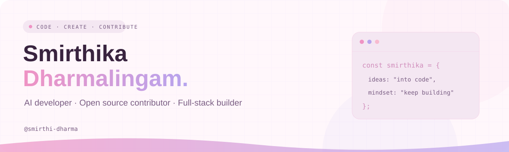
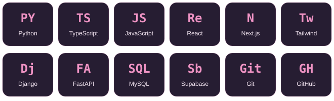

<picture>
  <source media="(prefers-color-scheme: dark)" srcset="art/banner-dark.svg" />
  
</picture>

<h1 align="center">Hey there, I'm Smirthika 🌸</h1>

  

  
  

<h2 align="center">A little about me</h2>

<table align="center">
<tr>
<td width="65%">
<h3>Building where AI meets everyday experiences.</h3>

I'm <strong>Smirthika Dharmalingam</strong>, an AI developer, open source contributor, and full-stack builder.

🌱 My public workspace spans <strong>personal AI agents, consent-driven experiences, and web applications</strong>.

🛠️ I enjoy connecting thoughtful interfaces with the APIs and systems behind them.

✦ Explore my repositories below, or connect with me on LinkedIn.

</td>
<td width="35%" align="center">

 Curiosity → Code → Creation
</td>
</tr>
</table>

<h2 align="center">Tools in my project ecosystem</h2>

From interfaces to APIs, and ideas to working products.

  

<h2 align="center">Explore my workspace</h2>

A selection of public forks in my GitHub workspace.

| Project | What you'll find | Stack |
| :--- | :--- | :--- |
| 🌸 **[Hushh Research](https://github.com/smirthi-dharma/hushh-research)** | Personal AI agents, consent flows, and a user-controlled data vault. | Next.js · Python · FastAPI |
| ✦ **[Hushh Tech Website](https://github.com/smirthi-dharma/hushh_Tech_website)** | Public web experiences, API integrations, and app wrappers. | TypeScript · Supabase |
| 🛍️ **[Super Market](https://github.com/smirthi-dharma/e-commerce-)** | A mobile-first storefront with a cart, checkout, and an admin workspace. | React · Django · MySQL |

<h2 align="center">A little progress, every day</h2>

<h3 align="center">Watch my contributions bloom</h3>
<!-- Generated daily by .github/workflows/contribution-snake.yml. -->

<picture>
  <source media="(prefers-color-scheme: dark)" srcset="https://raw.githubusercontent.com/smirthi-dharma/smirthi-dharma/output/github-snake-dark.svg" />
  
</picture>

<h2 align="center">Let's connect</h2>

Ideas, open source, and things worth building.

  
  

Thanks for stopping by. Let's make something useful. ✦

